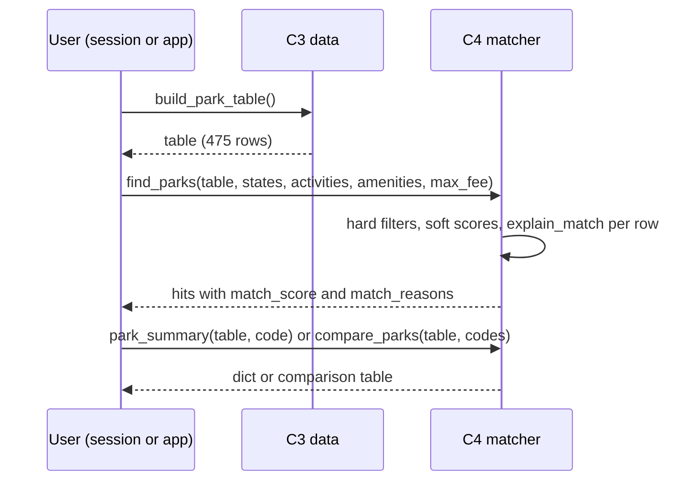

# ParkMatch component specification

CSE 583, Autumn 2026. This document lists the parts of the `parkmatch` package, their inputs and outputs, and how they work together for the use cases in `design/use_cases.md`. Background, user profiles and data sources are in `docs/functional_specification.md`.

## Overview

We are keeping the package small on purpose. The lecture on 2026-11-03 asked for few components with clear roles and few interactions between them, and our problem does not need more: get two public NPS data sources into tidy tables, join them, filter and rank parks, show the result. The seven components form a chain from raw download to screen, and most of them talk only to their neighbor. Sprint 1 (by 2026-11-14) builds the first four, which already cover UC1, UC2, UC3, UC6 and UC7 from a Python session. The map (C5) waits for the technology review on 2026-11-17, and the Streamlit app (C6) and the climate module (C7) come after that, so their interfaces below are a plan that will change once we have tried the libraries.

- C1 `nps_api` (sprint 1): thin client that downloads whole NPS API tables as JSON.
- C2 `snapshot` (sprint 1): turns those files and the IRMA visitation CSV into six small bundled CSV tables. UC7.
- C3 `data` (sprint 1): loads the bundled tables as pandas DataFrames and joins them into one row per park.
- C4 `matcher` (sprint 1): filters, scores, explains, compares, searches and summarizes parks. UC1, UC2, UC3, UC6.
- C5 `maps` (after the technology review): the interactive map and the plain table that stands in for it. UC4.
- C6 `app` (after the technology review): the Streamlit page that wires C3, C4 and C5 into form, results, detail, comparison and map views.
- C7 `climate` (sprint 2): monthly temperature normals from Open-Meteo for the second half of UC5.

## Software components

### C1 `nps_api`: API client

- **Name:** `parkmatch.nps_api`
- **What it does:** Downloads complete tables from `https://developer.nps.gov/api/v1/` and saves them as JSON, one file per endpoint. The API answers in pages inside `{"total", "limit", "start", "data"}`; the client raises `start` until it holds `total` records (our five endpoints each fit in one request).
- **Inputs (with types):** endpoint name (`str`), API key (`str`, or `None` to read `NPS_API_KEY`), page size (`int`, default 1000); `download_raw` also takes an output directory (`str | Path`) and a tuple of endpoint names.
- **Outputs (with types):** `fetch_all` returns the concatenated `data` list (`list[dict]`); `download_raw` returns the written files as a `dict[str, Path]` from endpoint to path, with `/` in an endpoint name written as `_` (`amenities_parksplaces.json`).
- **How it uses other components:** none; it only uses `requests`. C2 reads its files but does not import it.
- **Side effects:** network requests and files in the output directory. `DEMO_KEY` allows 30 requests per hour, so the client raises an error naming HTTP 429 instead of returning a partial table. Tests replace `requests.get` with a fake.

```python
def fetch_all(endpoint: str, api_key: str | None = None, limit: int = 1000) -> list[dict]
def download_raw(out_dir: str | Path, api_key: str | None = None,
                 endpoints: Iterable[str] = ("parks", "campgrounds", "visitorcenters",
                                             "amenities/parksplaces", "feespasses"),
                 limit: int = 1000) -> dict[str, Path]
```

`fetch_all` requests one endpoint page by page and returns every record in one list. `download_raw` calls it per endpoint and writes `<endpoint>.json` in the API's own `{"total", "data"}` shape, so hand-downloaded files look the same. We plan to add `thingstodo` later; the package must keep working without it.

### C2 `snapshot`: snapshot builder (UC7)

- **Name:** `parkmatch.snapshot`
- **What it does:** Reads the raw JSON files and the IRMA file `Main_Data.csv` and writes the six bundled CSV tables listed under Data tables, plus `SNAPSHOT.md`. Only maintainers run it; the tables ship inside the package.
- **Inputs (with types):** `raw_dir` (`str | Path`, holding the five JSON files; `feespasses.json` may be missing, in which case `fee_free` stays empty), `visitation_csv` (`str | Path`, the 72 MB `Main_Data.csv` with columns `UnitCode, Year, Month, Statistic, Value`), `out_dir` (`str | Path`, normally `src/parkmatch/data/`).
- **Outputs (with types):** the CSV files and `SNAPSHOT.md` on disk, and a `dict[str, int]` from file name to row count for the log and the tests.
- **How it uses other components:** none at run time. It consumes what C1 writes and produces what C3 reads, and it is the only module that knows the raw API field names.
- **Side effects:** overwrites the previous snapshot in `out_dir`. Reading the visitation CSV takes a few seconds and a few hundred MB of memory, which is why it happens here and never at import time.

```python
def build_snapshot(raw_dir: str | Path, visitation_csv: str | Path, out_dir: str | Path) -> dict[str, int]
```

`build_snapshot` flattens each park record (first image, `|`-joined activities and topics, per-vehicle and per-person fees, the fee-free flag from `feespasses`, and `entrance_fee_min`), summarizes each campground, unpacks the amenity groups into one row per park and amenity, sums `TRV` (recreation visits) and `TOS` (overnight stays) per unit and year, maps `UnitCode` to a park code by lowercasing plus the alias table, and builds the 2021 to 2025 monthly profile. `python -m parkmatch.snapshot --raw-dir data/raw --visitation data/raw/Main_Data.csv --out-dir src/parkmatch/data` runs the same function; `--download` and `--download-visitation` fetch the raw files first.

### C3 `data`: data manager

- **Name:** `parkmatch.data`
- **What it does:** Finds the bundled CSVs with `importlib.resources`, loads each as a DataFrame with the right dtypes, and joins them into the one-row-per-park table every other component works on. It is the only module that knows where the data lives.
- **Inputs (with types):** none for the six loaders; `build_park_table(visit_years=(2021, 2022, 2023, 2024, 2025))` takes the years that get a visits column.
- **Outputs (with types):** `pandas.DataFrame` in every case. `load_parks()` has 475 rows and the 18 columns of `parks.csv`. `build_park_table()` adds `campground_count` (int), `rv_campground_count` (int), `visitor_center_count` (int), `has_campground` (bool), `amenities` (str, `|`-joined), one `recreation_visits_<year>` column per requested year (float, NaN when the park has no record), and `busiest_month` and `quietest_month` (month names, NaN when there is no profile).
- **How it uses other components:** none. It reads what C2 wrote; C4, C5 and C6 call it.
- **Side effects:** file reads only. We plan to cache the loaders with `functools.lru_cache` so a Streamlit rerun does not reread the files.

```python
def load_parks() -> pd.DataFrame
def load_campgrounds() -> pd.DataFrame
def load_visitor_centers() -> pd.DataFrame
def load_amenities() -> pd.DataFrame
def load_visitation() -> pd.DataFrame
def load_monthly_profile() -> pd.DataFrame
def build_park_table(visit_years: Iterable[int] = VISIT_YEARS) -> pd.DataFrame
```

Each loader reads one CSV, keeps `|`-joined fields as strings and parses numbers as floats or nullable integers. `build_park_table` left-joins the counts, the amenity list, the requested years of `visitation_annual.csv` (summed over the IRMA units that map to the park) and the busiest and quietest month from `visitation_monthly.csv` onto `load_parks()`.

Unknown stays `NaN` and is never turned into `0` or `False`. Only four units have an unknown fee (not marked fee free in `feespasses`, and no per-person or per-vehicle row); they get `NaN` in `entrance_fee_min`, while the 364 fee-free units without fee rows get 0. 82 units have no IRMA visitation series after aliasing and get `NaN` in every visits column and in both months. Counts are different: a park absent from the campgrounds endpoint gets `campground_count = 0` and `has_campground = False`, because that endpoint covers every park and absence means the NPS lists none. Downstream code checks `pd.isna` before comparing, and the reasons text says "fee information not available" rather than "free".

### C4 `matcher`: filtering, scoring and summaries

- **Name:** `parkmatch.matcher`
- **What it does:** Pure functions over the park table: filter and rank parks (UC1), explain each match in one sentence, look up one park (UC2), compare two or three (UC3), search by name (UC6). It never reads files or touches the network, so a ten-row DataFrame is enough to test it.
- **Inputs (with types):** the C3 table (`pd.DataFrame`) and the keyword arguments in the signature below: lists of state codes, activity, topic and amenity names spelled as in the API vocabulary, a fee ceiling, a campground flag, a visits range, a year, and the unknown-fee switch. `compare_parks` takes park codes, `search_parks` a string, `park_summary` one code.
- **Outputs (with types):** `find_parks`: the table's columns plus `match_score` (float, 0 to 1) and `match_reasons` (str), best first. `compare_parks`: attributes as rows, park codes as columns. `search_parks`: the matching rows. `park_summary`: a `dict` with the fields UC2 asks for (designation, states, description, first image with alt text, activities, topics, fees, counts, latest recreation visits, busiest and quietest month, nps.gov link).
- **How it uses other components:** it takes the C3 table as an argument and imports only the `split_multi` helper from C3; `year` picks one of the table's `recreation_visits_<year>` columns and raises `KeyError` when it is missing. C6 calls every function here.
- **Side effects:** none; inputs are not modified.

```python
def find_parks(parks: pd.DataFrame, states: list[str] | None = None,
               activities: list[str] | None = None, topics: list[str] | None = None,
               max_fee: float | None = None, amenities: list[str] | None = None,
               needs_campground: bool = False, max_visits: int | None = None,
               min_visits: int | None = None, year: int = 2025,
               include_unknown_fee: bool = False) -> pd.DataFrame
def explain_match(row: pd.Series, states: list[str] | None = None,
                  activities: list[str] | None = None, topics: list[str] | None = None,
                  max_fee: float | None = None, amenities: list[str] | None = None,
                  needs_campground: bool = False, max_visits: float | None = None,
                  min_visits: float | None = None, year: int = 2025) -> str
def compare_parks(parks: pd.DataFrame, codes: list[str]) -> pd.DataFrame
def search_parks(parks: pd.DataFrame, text: str) -> pd.DataFrame
def park_summary(parks: pd.DataFrame, code: str) -> dict
```

Scoring rule. `find_parks` runs two passes. The hard filters come first, and a park either passes or not: `states` (the park's `states` shares a code with the request), `max_fee` (`entrance_fee_min <= max_fee`; `NaN` fees are dropped unless `include_unknown_fee=True`), `needs_campground` (`campground_count > 0`), and `min_visits` or `max_visits` (visits for `year` inside the range; `NaN` visits are dropped when a bound is given, since we cannot say whether they qualify). Then the soft criteria are scored: every requested activity, topic and amenity counts as one criterion, and `match_score` is the number satisfied divided by the number requested, so a park meeting three of four gets 0.75. When any soft criterion was given, parks with score 0 are dropped; when none was given, every park that passed the hard filters keeps a score of 1.0. The result is sorted by `match_score` descending, then `recreation_visits_<year>` descending with unknown visits last, then by name, so among equal scores the better-known parks come first. A park missing one of several requested activities is therefore kept with a lower score: full matches rank first and near misses stay visible.

Match reasons. `explain_match` takes one result row and the requested lists and returns one sentence of short clauses, for example "In WA; offers Hiking and Camping; covers Geology; does not list Restroom - Accessible; lowest entrance fee $15; 2 campgrounds." It names the requested states the park is in, the requested activities, topics and amenities it has and the ones it does not list, then the fee when a limit was given ("fee information not available" when `NaN`), the campground count when one was required, and the visit count when a visit range was given. `find_parks` stores the sentence in `match_reasons`.

`compare_parks` selects the rows for the given codes (`ValueError` for an unknown code) and transposes a fixed attribute list (name, designation, states, the three fee columns, campground, RV campground and visitor center counts, every `recreation_visits_<year>` column, busiest and quietest month, link), then adds the number of activities and a yes/no row for five amenities; it needs at least two codes, and the app will cap the pick at three. `search_parks` lowercases both sides and keeps rows whose `full_name`, `name` or `park_code` contains the text, so "rainier" finds Mount Rainier National Park. `park_summary` returns the dict above, with `fee_text` as a short string ("$30 per vehicle, $15 per person" or "fee information not available") and the months as integers or `None`; for Olympic, August is the busiest month (about 20 percent of a year's visits) and January the quietest (under 3 percent).

### C5 `maps` (planned, after the technology review)

- **Name:** `parkmatch.maps`
- **What it does:** One marker per park on an interactive map with a popup (name, designation, states, score, first clause of the reasons), plus the plain table that stands in for the map for screen-reader and low-vision users (UC4, user story 29).
- **Inputs (with types):** a `pd.DataFrame` with at least `park_code`, `full_name`, `latitude`, `longitude` (normally `find_parks` output) and an optional list of popup columns.
- **Outputs (with types):** `park_map` returns the library's map object (`folium.Map` if folium wins the review, a Plotly figure otherwise); `parks_as_table` returns a `pd.DataFrame` with the same parks in marker order and the columns a reader needs to choose without the map: name, states, designation, score, visits, link.
- **How it uses other components:** none directly; C6 hands it C3 or C4 output.
- **Side effects:** none; rendering happens in the app.

```python
def park_map(parks: pd.DataFrame, popup_columns: list[str] | None = None) -> "folium.Map"
def parks_as_table(parks: pd.DataFrame) -> pd.DataFrame
```

This is our technology-review topic for 2026-11-17 (folium, Plotly, pydeck) and the signatures will be revised after it. We lean toward folium because its popups take plain HTML and it has a Streamlit component, but we have not tested keyboard access to the markers yet, which matters for Leo.

### C6 `app` (planned, after the technology review)

- **Name:** `app/streamlit_app.py` (a script, not part of the installed package)
- **What it does:** The web page for people who do not use Python. A sidebar form collects the UC1 inputs (state, activity, topic and amenity pickers filled from the table's vocabularies, a fee slider with an "include parks with unknown fees" checkbox, a campground checkbox, a visits range). The main area shows the ranked table with reasons, a detail panel (UC2), a side-by-side comparison of up to three parks (UC3), the map with its table alternative (UC4), the monthly profile chart (UC5) and a name search box (UC6).
- **Inputs (with types):** widget values (strings, lists of strings, floats, booleans) turned into the keyword arguments of `find_parks`.
- **Outputs (with types):** Streamlit widgets: `st.dataframe` tables, `st.image` with alt text, a bar chart of `share_of_year` by month, the map component.
- **How it uses other components:** `build_park_table()` once (cached with `st.cache_data`), then C4 on every interaction, C5 for the map view, later C7.
- **Side effects:** none beyond the browser session; no accounts, no writes.

All logic stays in the package so the tests cover it and the app only arranges widgets. The accessibility choices (a label on every control, the table alternative shown next to the map by default, no information carried by color alone) are in the functional specification and will be checked by hand before 2026-12-01. The layout will be revised after the technology review.

### C7 `climate` (planned, sprint 2)

- **Name:** `parkmatch.climate`
- **What it does:** Fetches daily maximum and minimum temperature from the Open-Meteo historical archive (ERA5 reanalysis, about 9 km grid, free for non-commercial use, CC BY 4.0 attribution) for a park's coordinates and reduces them to twelve monthly normals, for the "how warm is it in month X" half of UC5 that seven user stories ask about.
- **Inputs (with types):** `lat`, `lon` (`float`, from `parks.csv`), `years` (`tuple[int, int]`), an optional cache directory (`str | Path`, default `.parkmatch_cache/`).
- **Outputs (with types):** a `pd.DataFrame` with `month` (int), `mean_tmax_c` and `mean_tmin_c` (float).
- **How it uses other components:** none; C6 passes in coordinates from the C3 table.
- **Side effects:** one request per park and year range, cached as JSON so a park is fetched once. Tests will use a recorded response.

```python
def monthly_temperature(lat: float, lon: float, years: tuple[int, int] = (2015, 2024),
                        cache_dir: str | Path = ".parkmatch_cache") -> pd.DataFrame
```

This is a sketch. We verified one request (Yellowstone, January 2024) and nothing more, so column names and caching will be revised when we build it after 2026-11-26.

## Data tables

The six CSV files in `src/parkmatch/data/` are the contract between C2 (writes), C3 (reads) and everything downstream, which only sees the DataFrames C3 builds; a change in the NPS API touches C2 alone. Conventions for every table: UTF-8, one header row, lowercase `snake_case` columns, lowercase four-letter park codes (`olym`), multi-valued fields stored as one `|`-joined string (`Hiking|Camping|Fishing`) that helpers split, and missing values as empty cells that pandas reads as `NaN`. Sizes come from a trial build on the 2026-11-05 downloads and may differ by a few KB; the total is about 1.7 MB, under our 2 MB budget for package data.

**`parks.csv`** (475 rows, about 710 KB): `park_code` (str), `full_name` (str), `name` (str), `designation` (str, blank for 35 units), `states` (str, comma list as in the API), `latitude` (float), `longitude` (float), `description` (str), `url` (str), `activities` (str, `|`-joined, 104 distinct names), `topics` (str, `|`-joined, 189 names), `entrance_fee_min` (float: the lowest non-zero per-person, per-vehicle or motorcycle fee, 0 for a fee-free unit without such a row, `NaN` for the 4 unknown units), `fee_per_vehicle` (float or `NaN`), `fee_per_person` (float or `NaN`), `fee_free` (bool, from `feespasses.isFeeFreePark`), `image_url` (str), `image_alt` (str), `weather_info` (str, free text). Source: NPS API `parks` and `feespasses` endpoints, one row per unit; the two text columns make it the largest file.

**`campgrounds.csv`** (665 rows, about 170 KB): `park_code` (str), `name` (str), `latitude` (float), `longitude` (float), `total_sites` (int), `reservable_sites` (int), `rv_allowed` (bool, from the API's 0/1 flag; 328 allow RVs), `potable_water` (str, `|`-joined API strings such as `Yes - seasonal`), `toilets` (str, `|`-joined; the explicit `No Toilets` stays as text, an empty list becomes `NaN`), `dump_station` (str), `wheelchair_access` (str), `url` (str). Source: NPS API `campgrounds` endpoint; 118 parks have at least one.

**`visitor_centers.csv`** (714 rows, about 80 KB): `park_code` (str), `name` (str), `latitude` (float), `longitude` (float), `url` (str). Source: NPS API `visitorcenters` endpoint; 397 parks have at least one.

**`amenities.csv`** (9,359 rows, about 250 KB): `amenity` (str, one of 127 names such as `Restroom - Accessible` or `Bus/Shuttle Stop`), `park_code` (str); 410 parks appear. Source: NPS API `amenities/parksplaces`, unpacked from its nested list.

**`visitation_annual.csv`** (about 16,100 rows, about 410 KB): `park_code` (str, after the alias table), `unit_code` (str, original IRMA code, `SEQU+KICA` for the merged pair), `year` (int, 1979 to 2025), `recreation_visits` (int, sum of twelve monthly `TRV` values), `overnight_stays` (int, sum of `TOS`, `NaN` when not reported). Source: NPS Visitor Use Statistics Data Package 2025, `Main_Data.csv` (DOI 10.57830/2317666), 2,905,440 rows and 406 units reduced to annual totals; test check values GRSM 2024 = 12,191,834, ZION 2024 = 4,946,592, OLYM 2024 = 3,717,267, MORA 2024 = 1,620,006.

**`visitation_monthly.csv`** (about 4,800 rows, about 110 KB): `park_code` (str), `month` (int), `mean_recreation_visits` (float, mean of that month's `TRV` over 2021 to 2025), `share_of_year` (float, that mean divided by the sum of the twelve means). Source: the same `Main_Data.csv`, twelve rows per unit with data in those years.

**`SNAPSHOT.md`** records the download date 2026-11-05, the source URLs and DOI, the row counts, the rebuild command and the alias table. The alias table is a small dictionary in `snapshot.py` for the IRMA codes that lowercasing does not match; 391 of the 406 IRMA units match by lowercasing alone. Nine codes are mapped by hand: `SEQU` and `KICA` (Sequoia and Kings Canyon) into `seki`, `ROLA` and `LACH` (the Ross Lake and Lake Chelan recreation areas) into `noca` together with `NOCA`, `JEFM` (Thomas Jefferson Memorial) to `thje`, `NCPE` (National Capital Parks-East) to `nace`, `OBRI` (Obed Wild and Scenic River) to `obed`, `PERL` (Pearl Harbor National Memorial) to `valr` and `PRPA` (President's Park) to `whho`. Units that share a park code are summed. `JEFM` is not Gateway Arch: IRMA carries the arch as `JEFF`, which matches `jeff` by lowercasing. The six remaining IRMA-only codes (`FOCA`, `JODR`, `JOFK`, `NACA`, `NAVC`, `NCPC`) stay unmatched, and the 82 API units without a series keep `NaN` visitation. The table has its own test.

## Interactions to accomplish use cases

### UC1: find parks that match my preferences

Sarah wants a park in Washington with hiking and camping, restrooms, and an entrance fee of at most $35.

1. The user (a Python session now, the Streamlit form later) calls `table = parkmatch.build_park_table()`. C3 reads the six CSVs, joins counts, amenities and the 2021 to 2025 visits columns onto the 475 park rows and returns the table, once per session.
2. The user calls `hits = parkmatch.find_parks(table, states=["WA"], activities=["Hiking", "Camping"], amenities=["Restroom"], max_fee=35)`. C4 applies the hard filters: rows whose `states` includes `WA`, then `entrance_fee_min <= 35`, dropping unknown fees because `include_unknown_fee` is `False`.
3. C4 scores the three soft criteria for each remaining row (`Hiking` and `Camping` in `activities`, `Restroom` in `amenities`): all three gives 1.0, two gives 0.667, none is dropped. It calls `explain_match` per kept row and writes the sentence into `match_reasons`.
4. C4 sorts by `match_score`, then `recreation_visits_2025` (descending, unknown last) and returns the DataFrame; the input table is unchanged and nothing is written.
5. The user reads `hits[["park_code", "full_name", "match_score", "match_reasons"]]`, or sees the same table in the app with photos. From there one code goes to `park_summary` (UC2), two or three to `compare_parks` (UC3), or the whole frame to `park_map` (UC4).



### UC4: see parks on a map and pick by location

Leo needs the table; Alex wants the map. Both start from a result set.

1. C6 holds `table` (C3) and `hits` (C4, UC1 steps 1 to 4); with no filters yet, `hits` is the whole table restricted by the optional state filter.
2. C6 calls `parks_as_table(hits)`. C5 returns name, states, designation, score, visits and link in marker order, and C6 renders it with `st.dataframe` before the map, so keyboard and screen-reader users reach the list first and nothing depends on the map loading.
3. C6 calls `park_map(hits)`. C5 builds one marker per row from `latitude` and `longitude` with the popup text and returns the map object; C6 renders it with the Streamlit component for the chosen library.
4. The user clicks a marker or a row; C6 calls `park_summary(table, code)` (C4) and fills the detail panel: photo with alt text, description, fees or "fee information not available", counts, 2025 visits, busiest and quietest month, nps.gov link. Nothing is written.

### UC7: refresh the data snapshot (maintainer)

1. The maintainer sets `NPS_API_KEY` and runs `parkmatch.nps_api.download_raw("data/raw")`; C1 fetches the five endpoints and writes five JSON files, or stops with a message naming the 429 rate limit.
2. The maintainer downloads `Main_Data.csv` (72 MB, URL in `SNAPSHOT.md`) into `data/raw/` by hand and runs `python -m parkmatch.snapshot` with the three paths; C2 rebuilds the six CSVs and `SNAPSHOT.md` with the new date.
3. `pytest` checks row counts, the check values above, and that fee and visitation columns still hold `NaN` rather than zeros; then the tables are committed. `data/raw/` is in `.gitignore`, so the 72 MB file never enters the repository.

## Preliminary plan

Priority follows the course deadlines and the dependency chain (data before matcher, matcher before map, map before app). Owners marked "to assign at the next meeting" will be settled on 2026-11-10.

| Priority | Task | Component | Target date | Owner |
|---|---|---|---|---|
| 1 | `design/use_cases.md` in the slide-53 template, UC1 to UC7 from the 30 user stories | all | 2026-11-10 | Esa |
| 2 | Functional specification and this component specification | all | 2026-11-10 | Esa |
| 3 | Package skeleton: `pyproject.toml`, `LICENSE`, `.gitignore`, `src/parkmatch/` with the sprint 1 modules and docstrings, `tests/`, `examples/find_parks_example.py` | all | 2026-11-14 | Esa |
| 4 | C1 client with paging, environment key and 429 error, tested with a fake `requests.get` | C1 | 2026-11-14 | Esa |
| 5 | C2 snapshot builder, the six bundled CSVs, alias table, `SNAPSHOT.md` | C2 | 2026-11-14 | Esa |
| 6 | C3 loaders and `build_park_table()` with the NaN rules, tested on the bundled data | C3 | 2026-11-14 | Esa |
| 7 | Continuous integration: `ruff check .` and `pytest` on Python 3.11 and 3.13 | all | 2026-11-14 | Esa |
| 8 | Technology review talk on maps (folium, Plotly, pydeck), including keyboard access and the table alternative | C5 | 2026-11-17 | to assign at the next meeting |
| 9 | Matcher: check `find_parks` and `explain_match` against UC1, add tests for compare, search and summary, settle the activities question below | C4 | 2026-11-19 | to assign at the next meeting |
| 10 | C5 `park_map` and `parks_as_table` with the chosen library | C5 | 2026-11-19 to 2026-11-26 | to assign at the next meeting |
| 11 | Matcher polish: unknown fees and visits, wording of the reasons, other years, the example script | C4 | 2026-11-19 to 2026-11-26 | to assign at the next meeting |
| 12 | C6 Streamlit app with the six views and the accessibility checklist | C6 | 2026-12-01 (standup) | to assign at the next meeting |
| 13 | C7 climate with cache and a recorded-response test, wired into UC5 | C7 | 2026-12-01 (standup) | to assign at the next meeting |
| 14 | README (audience, install, data, example, contributions), docs clean-up, presentation PDF in `docs/` | all | 2026-12-08 | to assign at the next meeting |
| 15 | Final presentation, 7 minutes, rehearsed once as a group | all | 2026-12-16 | to assign at the next meeting |

Open design questions we want to settle as a group:

- Whether requested activities should be a hard filter (UC1 says all must be present) or stay soft criteria, where a park missing one activity is kept with a lower score. We lean soft, with the score visible, because near misses help when a state has few parks.
- How unknown values should behave by default in the app: only four units have an unknown fee, so `include_unknown_fee` can probably start unchecked, but we still have to decide whether units without a visitation series are dropped or flagged when a visits bound is given.
- Whether one flat `match_score` is enough, or users should be able to weight activities, topics and amenities differently (Natalie's group trip); a weighted score is a small change in C4 but makes the reasons sentence harder to read.
- Which map library passes the keyboard and screen-reader check for Leo, and whether `find_parks` should keep its `year` argument now that the table carries one visits column per year. We lean toward keeping it, since it costs nothing.
